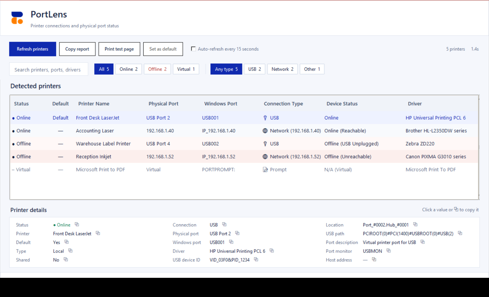
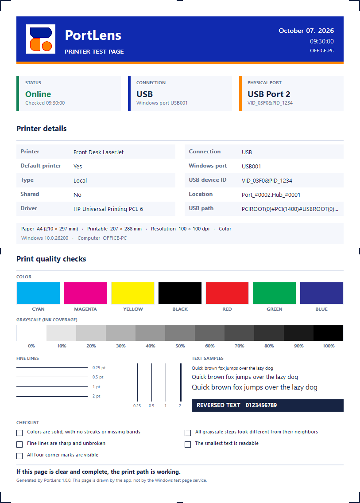

# PortLens

See which port every printer on your Windows PC is really connected to, and whether it is online.

[](https://github.com/irlanfazryana23/PortLens/actions/workflows/ci.yml)
[](https://github.com/irlanfazryana23/PortLens/releases/latest)
[](LICENSE)



PortLens is a small desktop tool for IT staff and anyone who supports printers. It answers the questions that Windows makes hard to answer: *Which USB socket is this printer plugged into? Is it actually reachable, or only installed? Which printer is using which port?*

## Download

1. Open the [latest release](https://github.com/irlanfazryana23/PortLens/releases/latest).
2. Download **PortLens-x.y.z-portable.zip** and extract it.
3. Run **PortLens-x.y.z.exe**. There is nothing to install.

Windows 10 or 11 is required. The EXE is not code-signed, so Windows SmartScreen may warn you the first time. Compare the ZIP with `SHA256SUMS.txt` from the release page if you want to check the download:

```powershell
(Get-FileHash .\PortLens-1.0.0-portable.zip -Algorithm SHA256).Hash
```

## What it does

- **Lists every printer** with its physical port, Windows port, connection type, driver and status.
- **Shows clear status**: `Online`, `Offline` or `Virtual`, as text and color, so it still works if you cannot tell colors apart.
- **Search and filter** as you type. Status chips (All, Online, Offline, Virtual) and connection chips (USB, Network, Other) show live counts.
- **Sort** by clicking any column header.
- **Copies details quickly**: click any value in the details panel, or use **Copy report** for the printers currently shown.
- **Flags port changes**: if a printer moves to a different USB socket between scans, the row is marked and the status bar says so.
- **Prints a diagnostic test page** with printer and connection details, color swatches, a grayscale ramp, fine lines, text samples, corner marks and a checklist.
- **Set as default**, open **printer properties**, or open the **print queue** from the right-click menu.
- **Auto-refresh** every 15 seconds, if you turn it on.
- **Remembers** your sort and filter choices between launches.

### Physical port and Windows port

They are two different things, and PortLens shows both.

| | Physical Port | Windows Port |
| --- | --- | --- |
| What it is | Where the cable or network connection actually lands | The port name Windows sends print jobs to |
| USB example | `USB Port 2` (the socket on the PC or hub) | `USB001` |
| Network example | The printer's IP address | `IP_192.168.1.40` or a `WSD-...` port |

Windows numbers USB ports in the order it first saw each device, so `USB001` does not tell you which socket to look at. When you move a USB printer to another socket, the Windows port usually stays the same and the physical port changes.

### How status is decided

| Connection | How PortLens checks |
| --- | --- |
| USB | The printer's Plug and Play state in Windows, plus the "Use Printer Offline" setting |
| Network (TCP/IP, WSD, shared) | One `ping` to the printer's address |
| Parallel / serial | The Windows "Use Printer Offline" setting |
| PDF, XPS, OneNote, fax and similar | Shown as **Virtual**, with no status |

The ping result is a reachability hint. A printer can answer a ping and still be out of paper or stuck, and some printers do not answer pings at all.

### Test page



The page fits Letter, A4 and A5. Check that all colors are solid, the grayscale steps are distinct, fine lines are unbroken, the small text is readable and all four corner marks are visible. A clipped corner mark means the printer cuts off that margin.

## Privacy

PortLens runs entirely on your PC. It reads printer information from Windows, runs a few short PowerShell queries, and pings the addresses of network printers. It does not send data anywhere and has no telemetry. Settings are stored in `%APPDATA%\PortLens\settings.json`.

## Run from source

Requires Windows and Python 3.10 or newer.

```powershell
python -m pip install -r requirements.txt
python portlens.py
```

## Build and test

```powershell
python -m pip install -r requirements-dev.txt
python -m pytest
powershell -NoProfile -ExecutionPolicy Bypass -File .\build.ps1
powershell -NoProfile -ExecutionPolicy Bypass -File .\scripts\verify.ps1
```

`build.ps1` creates these files in `dist/` (ignored by Git):

```text
PortLens-1.0.0.exe
PortLens-1.0.0-portable.zip
SHA256SUMS.txt
```

`verify.ps1` inspects the output (version information, package contents and checksums) without launching the app.

## Project layout

| Path | Purpose |
| --- | --- |
| `portlens.py` | The app: window, scanning, actions |
| `view_logic.py` | Filtering, sorting and status logic (no UI, fully tested) |
| `print_page.py` | Draws the diagnostic test page |
| `settings_store.py` | Remembered settings |
| `app_info.py` | Version and bundled-file lookup |
| `assets/` | Icon, logo and the source artwork |
| `tests/` | pytest suite |
| `scripts/` | Build helpers and release tooling |
| `.github/` | CI, release workflow and contribution templates |

## Contributing

Bug reports and pull requests are welcome. See [CONTRIBUTING.md](CONTRIBUTING.md). Maintainers: see [docs/RELEASING.md](docs/RELEASING.md) for how to publish a release.

## License

[MIT](LICENSE). Copyright 2026 PortLens contributors.
